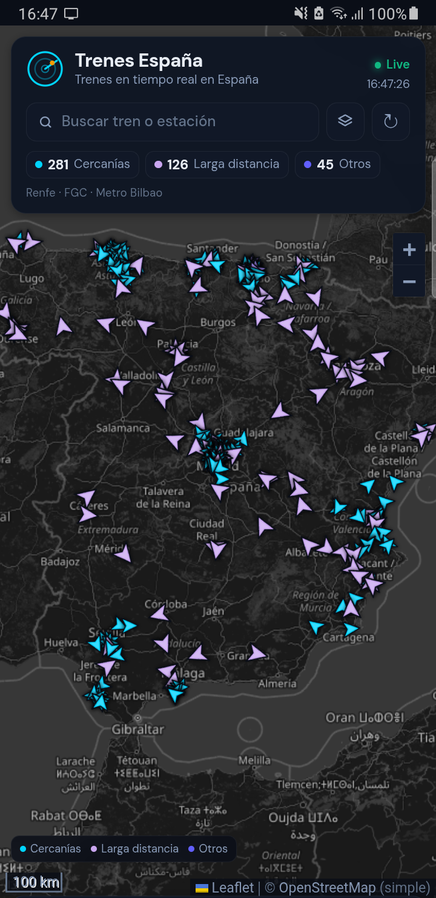

# Trenes España


App Android para ver **trenes en tiempo real en España** sobre un mapa oscuro.
Muestra Renfe (Cercanías, AVE, AVLO, Alvia, Avant, Euromed, Intercity, Regional y Media Distancia), FGC y Metro Bilbao.

<br clear="left">



## Funciones

- Mapa con flechas orientadas al rumbo y velocidad actual calculada por GPS.
- Búsqueda por tren, línea o estación; filtros y rutas.
- Ficha con retraso total y por parada, paradas intermedias con horarios previstos y comodidad estimada.
- Estaciones: lista de trenes que las tienen como destino.
- Capas de mapa: Estándar, Simple, Relieve y Oscuro.
- Datos en vivo cada 30 s.

## Datos y atribución

- Renfe Open Data (GTFS-RT y horarios), CC BY 4.0.
- FGC Open Data, CC BY 4.0.
- Metro Bilbao / CTB (SIRI).
- Mapas © OpenStreetMap (ODbL) y OpenTopoMap (CC BY-SA).
- Fotografías de series de tren: Wikimedia Commons / Wikipedia.
- Tipografía DM Sans (SIL OFL) desde Google Fonts.

Proyecto personal sin afiliación con Renfe ni con los operadores.

## Compilar

Requisitos: JDK 8+, Android SDK con build-tools 37.0.0 y plataforma android-34 en `~/.local/android-sdk`.

```bash
bash build.sh
adb install -r Trenes.apk
```

El APK firmado se publica en Releases. El `debug.keystore` se genera localmente y no se incluye.

## Estructura

- `assets/index.html`: interfaz, mapa y fichas.
- `src/com/rober/trenes/MainActivity.java`: WebView, descarga de feeds y parser GTFS-RT de FGC.
- `assets/*.js`: estaciones, rutas, horarios y otros operadores (generados con los scripts de `tools/`).
- `res/`: icono adaptativo.

## Limitaciones

- Solo se muestran operadores con posiciones abiertas en vivo. **Iryo y Ouigo no publican posiciones**; SNCF, Deutsche Bahn, Trenitalia, Italo, Eurostar y ÖBB requieren API keys o no ofrecen feed público de vehículos. Euskotren tampoco tiene feed accesible sin credenciales.
- La velocidad actual es una media entre posiciones GPS, no una lectura instantánea.
- En Larga Distancia, el retraso por parada aplica el retraso actual a todas las paradas.
- La comodidad es una estimación por servicio y material; no proviene de reseñas.
